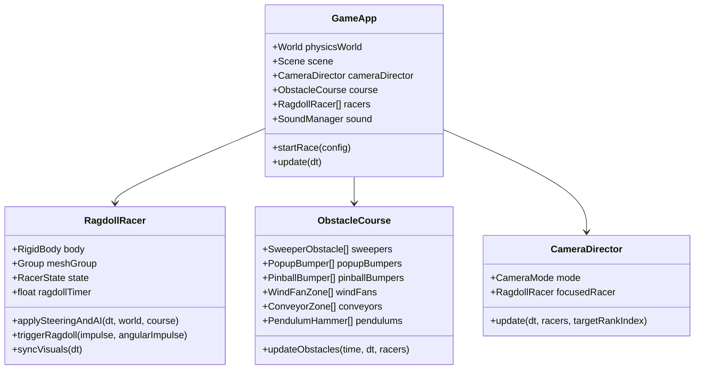

# 🏃‍♂️💥 Ragdoll Derby 3D (래그돌 더비 3D) — 기획 및 시스템 설계서

> **로블록스(R6) 스타일 3D 블록 캐릭터 & Rapier3D 액티브 래그돌 물리 기반 웹 장애물 레이스 추첨/내기 게임**

---

## 1. 기획 (Game Design Specification)

### 1.1 프로젝트 핵심 컨셉
- **장르**: 3D 물리 시뮬레이션 관전형 장애물 레이스 추첨기 (Marble Roulette 3D 진화형)
- **핵심 재미 요소**:
  1. **직관적인 타격감과 몸개그**: 단순 구슬이 아닌 팔·다리·몸통·머리가 달린 로블록스풍 R6 블록 캐릭터들이 회전 망치에 맞아 날아가고, 바닥 범퍼에 튕기며 공중제비를 도는 **액티브 래그돌(Active Ragdoll)** 연출
  2. **예측 불가한 역전 드라마**: 자율 주행 스티어링에 개체별 무작위성(좌우 흔들림, 점프 타이밍 편차, 순간 가속 편차)을 결합하고, 5단계 장애물 기믹(스위퍼, 팝업 범퍼, 선풍기 강풍, 컨베이어 벨트, 병목 진자 구간)을 배치하여 결승선 직전까지 순위가 뒤집히는 구조
  3. **박진감 넘치는 관전 카메라 & 슬로우 모션**: 선두 추적, 꼴찌 추적, 전체 탑뷰, 특정 참가자 클릭 밀착 마크 기능 및 결승선 통과 직전 **0.22배속 시네마틱 슬로우 모션** 연출
  4. **설치 없는 즉시 공유**: Three.js + Rapier3D(WebAssembly) 기반으로 제작되어 PC·모바일 브라우저 어디서든 60FPS로 즉시 실행

---

### 1.2 핵심 구현 기능 정의

| 구분 | 기능명 | 상세 기획 내용 |
| :--- | :--- | :--- |
| **캐릭터 & 물리** | **R6 블록 캐릭터 & 빌보드 UI** | 머리(표정 포함), 몸통, 양팔, 양다리 6개 파츠로 구성된 3D 캐릭터와 상단 고정 닉네임/순위 빌보드 텍스트 렌더링 |
| **캐릭터 & 물리** | **액티브 래그돌(Active Ragdoll)** | 평상시에는 직립 자세로 팔다리를 흔들며 달리고(`RUNNING`), 장애물 타격·고속 충돌 시 관절 제한 내 3축 회전과 사지 꺾임이 활성화되어 굴러떨어진 뒤(`RAGDOLL`) 기상(`RECOVERING`)하는 하이브리드 물리 |
| **자율 주행 AI** | **스티어링 + 무작위성 혼합** | 결승선(`+Z` 및 하강 경사) 방향 기본 추진력 + Perlin/Sinusoidal 좌우 흔들림(Wander) + 랜덤 점프 타이밍 + 코스 이탈 시 자동 체크포인트 리스폰 및 끼임 탈출 로직 |
| **장애물 기믹** | **5종 핵심 장애물 존** | ① 회전하는 망치(스위퍼) ② 바닥 팝업 범퍼 & 핀볼 기둥 ③ 밀어내는 대형 선풍기 바람 ④ 가속/역방향 컨베이어 벨트 ⑤ 좁아지는 병목 다리 & 대형 진자 해머 |
| **관전 연출** | **멀티 카메라 & 슬로우 모션** | 선두 그룹 카메라(`LEAD`), 꼴찌 카메라(`LAST`), 탑뷰 전체 조망(`TOP`), 자유/특정 캐릭터 포커스(`FREE`) 전환 + 결승선 직전 시네마틱 슬로우 모션(`0.22x`) |
| **내기/추첨 편의** | **멀티 엔트리 & 당첨 모드** | `이름*수량` 가중치 입력(예: `철수*3, 영희*2`), 프리셋 불러오기, **1등 당첨 / 꼴찌 당첨 / N등 당첨** 선택, 완주 포디움 및 결과 공유 |

---

### 1.3 코스 구간별 레벨 디자인 (총 길이 140m, 하강 경사형 트랙)

1. **START (Z: 0m ~ 12m) — 출발 대기실 & 동시 개방 게이트**
   - 참가자 수에 맞춰 그리드 대형으로 정렬. 카운트다운(`3, 2, 1, GO!`)과 함께 출발 게이트가 열리며 일제히 돌진.
2. **ZONE 1 (Z: 12m ~ 38m) — 회전하는 망치 / 스위퍼 존 (Spinning Sweeper Hammers)**
   - 트랙 중앙에서 서로 반대 방향으로 회전하는 대형 T자형·십자형 스위퍼 망치 3기 배치.
   - 다리 또는 몸통에 맞으면 강한 회전 임펄스(Impulse)와 함께 공중으로 튕겨 나가며 래그돌 상태로 구름.
3. **ZONE 2 (Z: 38m ~ 64m) — 바닥 팝업 범퍼 & 핀볼 바운서 존 (Pop-up Bumpers)**
   - 바닥에서 위아래로 피스톤 운동을 하며 캐릭터를 공중으로 쏘아 올리는 **팝업 스프링 범퍼** 6기와 접촉 시 강하게 튕겨내는 **네온 핀볼 범퍼 기둥** 7기 배치.
4. **ZONE 3 (Z: 64m ~ 92m) — 밀어내는 선풍기 바람 & 컨베이어 벨트 존 (Wind Fans & Conveyors)**
   - 트랙 좌우 외벽에 설치된 초대형 산업용 선풍기 3기가 횡방향 강풍(Wind Force Zone + 바람 궤적 파티클)을 불어 캐릭터를 반대편이나 난간 밖으로 밀어냄.
   - 바닥에는 **전방 초고속 컨베이어 벨트**와 **역방향 함정 컨베이어 벨트**가 교차 배치되어 라인 선택에 따라 순위가 급변함.
5. **ZONE 4 (Z: 92m ~ 118m) — 좁아지는 병목 구간 & 스윙 진자 해머 (Bottleneck & Pendulums)**
   - 트랙 폭이 `18m → 6.5m`로 급격히 좁아지는 깔때기(Funnel) 병목 다리.
   - 좁은 다리 위에서 좌우로 거대하게 흔들리는 **오버헤드 진자 해머(Swinging Pendulums)** 2기가 선두 그룹을 쓸어버리며 대역전극 연출.
6. **ZONE 5 (Z: 118m ~ 138m) — 최후의 부스트/범퍼 슬로프 & 결승선 (Final Chaos & Finish Line)**
   - 결승선 직전 마지막 고속 경사로와 미니 스위퍼.
   - 당첨 목표 순위(1등, 꼴찌, 또는 N등)에 해당하는 캐릭터가 결승선 전방 `10m` 구간에 진입하면 **슬로우 모션(`0.22x`)**이 발동되며 극적인 사진 판정 연출.

---

## 2. 시스템 아키텍처 및 기술 설계 (System Architecture)

### 2.1 기술 스택 (Tech Stack)
- **렌더링 엔진**: `Three.js` (WebGLRenderer, PCFSoftShadowMap, ACESFilmicToneMapping)
- **물리 엔진**: `@dimforge/rapier3d-compat` (Rust 컴파일 WebAssembly 3D 물리 엔진)
- **오디오 엔진**: `Web Audio API` 기반 무설치 프로시저럴 사운드 합성기 (`SoundManager.ts`)
- **이펙트**: 3D 충돌/점프/바람 파티클 시스템 + `canvas-confetti` 우승 폭죽
- **빌드 도구**: `Vite` + `TypeScript`

### 2.2 모듈 구조도

### 2.3 액티브 래그돌 & 물리 혼합 상세 설계
수십 명의 캐릭터가 동시에 장애물과 충돌할 때 웹 브라우저에서 60FPS를 유지하면서도 리얼한 래그돌 몸개그를 보여주기 위해 **Compound Dynamic Body + Articulated Procedural Limb & Ragdoll Physics** 구조를 채택합니다.

1. **물리 바디 (Rapier3D Dynamic RigidBody)**:
   - 각 캐릭터는 몸통+머리+다리 볼륨을 감싸는 캡슐 콜라이더(`CapsuleCollider`)와 상체/하체 보조 콜라이더를 지닌 동적 강체(`RigidBody`)로 생성됩니다.
   - **RUNNING 상태**:
     - `enabledRotations(false, true, false)`에 준하는 강한 직립 복원 토크(Upright PD Controller)가 작동하여 캐릭터가 넘어지지 않고 달립니다.
     - 팔(`LeftArm`, `RightArm`)과 다리(`LeftLeg`, `RightLeg`), 머리(`Head`) 관절이 이동 속도에 비례해 역동적으로 앞뒤 스윙 애니메이션을 수행합니다.
   - **RAGDOLL 상태 (피격/충돌 시)**:
     - 스위퍼 망치, 진자, 팝업 범퍼에 맞거나 상대 캐릭터와 강하게 충돌하면 즉시 `triggerRagdoll()`이 호출됩니다.
     - 직립 제어기가 해제되어 X/Y/Z 3축 전체 회전이 자유로워지며, 피격 방향 임펄스(`applyImpulse`)와 강한 회전 토크(`applyTorqueImpulse`)가 가해져 공중으로 날아가거나 바닥을 데구르르 구릅니다.
     - 동시에 팔·다리·머리 각 관절(Pivot)에 독립적인 각속도(Ragdoll Flail Angular Velocity)와 중력 처짐이 적용되어 로블록스 래그돌 특유의 팔다리가 덜렁거리며 날아가는 타격감을 완벽히 재현합니다.
   - **RECOVERING 상태 (기상)**:
     - 래그돌 타이머(`0.9~1.6초`)가 만료되고 바닥 근처에 닿으면 쿼터니언 구면 보간(`slerp`)으로 몸을 일으켜 세우며 다시 결승선을 향해 달리기 시작합니다.

### 2.4 자율 주행(Steering) 및 역전 밸런싱 알고리즘
- **전진 추진력**: 트랙 중심선(`X = 0`)과 다음 체크포인트(`+Z`)를 향한 목표 속도 벡터 계산
- **개체별 무작위성**:
  - `wanderPhase` & `wanderFreq`: 사인파 조합으로 캐릭터마다 서로 다른 주기로 좌우 라인을 변경하며 장애물과 우연히 마주치거나 회피
  - `jumpTimer`: `1.8~4.2초` 간격의 무작위 점프 및 전방 장애물 근접 시 회피 점프 시도
  - `comebackBoost`: 하위권으로 과도하게 처진 캐릭터에게 미세한 탄력 가속(Rubber-banding)을 부여해 중후반 병목 구간에서 대역전이 일어날 확률을 극대화
